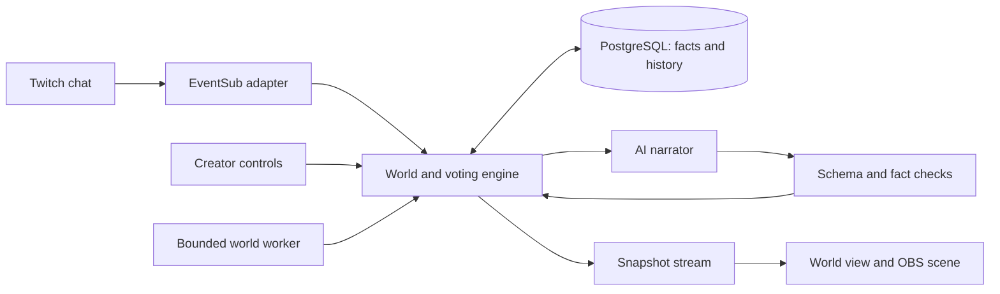

**AFTERLIFE — The stream ends. The world remembers.**

Project plan prepared on 30 October 2026 around the user's selected AFTERLIFE concept. The earlier Raid Parcel document is historical research. This document plans the work; application implementation has not started.

**Build target and schedule**

Build a persistent kingdom story for one Twitch channel, where two factions remember the community's choices across episodes. Demonstrate a betrayal in episode one, durable changes to the world, activity while the world rests, and an episode-two confrontation that refers to the original event.

Two people, each available for approximately 7–8 focused hours daily on Oct 30–Nov 2, is the scheduling assumption. Allocate about 26–28 planned hours per person plus 4 hours of contingency.

Ownership is confirmed: **the frontend teammate takes Person A; takes Person B and the backend**. The approximate technical-responsibility split is 40% frontend/presentation and 60% backend/AI/integration. These percentages describe responsibility and complexity; the scheduled hours remain estimates.

The live Devpost deadline was checked on Oct 30 IST: **November 3, 2026, 03:30 IST**, equivalent to November 2, 22:00 UTC / 14:00 PST. Target a complete submission by **November 2, 15:00 IST**, with feature freeze on November 1 evening. [Official event](https://twitchcon-codex.devpost.com/)

**Product loop**

1. The streamer opens an episode and sees a short “Previously in your kingdom” recap.
2. The world presents a dilemma involving Red and Blue.
3. Viewers join a faction with `!join red` or `!join blue`, then use `!vote 1`, `!vote 2`, or `!vote 3`.
4. Voting closes. The backend resolves the result and records exactly what changed.
5. AI narrates the consequence and voices the leaders' reactions. The map, trust meter, and event history update.
6. The episode ends. Limited background developments change the resting world.
7. The next episode loads the same world and introduces a dilemma caused by its history.

The community should see the causal connection: **“Blue is preparing retaliation because Red broke the Westbridge treaty in episode one.”** The interface links that claim to the recorded treaty-breaking event.

**MVP boundaries**

| Area | Build for submission | Later expansion |
| --- | --- | --- |
| World | One world per connected channel; two factions; two named leaders; four illustrated locations | Multiple regions, cross-channel worlds, complex economies |
| State | Supplies and morale for each faction; a shared trust value; location status; unresolved grievances | Detailed inventories, armies, skill trees |
| Participation | Persistent faction membership; three-option global majority votes; recorded individual contributions | Private objectives, faction-specific voting rules, rewards |
| Narrative | Three encounter families: treaty, resource crisis, retaliation; AI-generated wording and leader reactions | Arbitrary generated quest mechanics |
| Memory | Durable state, immutable events, episode records, cause links, recap | Embeddings and semantic search across large histories |
| Offline activity | A durable timer and bounded updates while the world rests | Fully autonomous continuous faction agents |
| Presentation | Creator console, spectator world view, OBS browser scene, event chronicle | Full 3D world, cinematics, custom asset generation per scene |
| Narration | Text with optional manual reveal | Voice, voice cloning, lip sync |
| Verification | Real Twitch votes, restart/resume, two episodes, one recorded offline consequence | Large-scale public launch and retention studies |

Faction affiliation provides identity and story context. The MVP uses one global vote per participating Twitch account; allegiance does not grant extra vote weight. Credit individual actions only when they are actually recorded. A community's winning choice does not mean every member of a faction voted for it.

**Ownership**

| Responsibility | Person A — frontend teammate | Person B — Backend teammate |
| --- | --- | --- |
| Main ownership | `apps/web/**`, visual assets, responsive layouts | `apps/server/**`, database migrations, Twitch integration, narrator, worker |
| Shared boundary | Consumes contract and maintains frontend fixture states | Maintains shared schemas and API behavior |
| Product QA | Readability, onboarding, interaction pacing, OBS checks | Persistence, vote correctness, event delivery, AI validation |
| Submission | Demo storyboard, recording/editing, screenshots, viewer instructions | Hosting, setup documentation, technical write-up, Codex evidence |
| Joint work | First-hour contract agreement; end-of-day integrated demo; real Twitch pilot | First-hour contract agreement; end-of-day integrated demo; real Twitch pilot |

Person A should help test memory scenarios and write concise fallback narration once the UI shell works. This balances the heavier integration work on Person B's side. Both should collect genuine Codex build evidence from the beginning.

Person A owns frontend implementation and presentation. Person B owns the backend, database, world engine, Twitch integration, AI narrator, background worker, deployment, and shared runtime schemas. Person A can begin from the agreed fixtures while Person B implements the real API. Backend work in this Codex workspace starts after this planning handoff.

**Suggested architecture**

Use TypeScript throughout: React/Vite for the web UI; a Node HTTP server such as Fastify for the API, server-sent events, and scheduled work; PostgreSQL for durable state; the OpenAI Responses API for narration; Twitch EventSub for chat and stream presence.

Deploy one long-running application service with PostgreSQL. Serve the built frontend from the same application origin to reduce integration overhead. Confirm the available host supports a continuously running process, outgoing WebSockets, server-sent events, and durable database access in Phase 0. Choose a service already familiar to the team; this plan does not depend on a particular hosting provider or pricing tier.

World changes happen through validated backend operations. AI receives the current state and selected historical facts, then returns structured narrative content. It cannot directly modify the database. The detailed interface is in [integration-contract.md](integration-contract.md).

**Memory design**

Store three distinct things:

- **Current facts:** faction resources, trust, location status, unresolved grievances, active episode, and pending decision.
- **Historical events:** who did what, the committed result, the episode, and the earlier event that caused it.
- **Narrative presentation:** scene text, leader reactions, and short recaps grounded in those records.

For each narration request, provide a compact current snapshot, the latest five relevant events, up to three unresolved grievances, and the event IDs the scene may reference. When a past vote matters, include a small set of recorded participants and their actual choices, so a returning viewer can be credited accurately. Keep entity names stable. Retain all canonical events in the database even when an AI-generated recap becomes shorter.

Begin with backend-defined action effects and encounter preconditions. The AI can select an eligible encounter family and write the scene around it; the backend validates the selection. For example, a retaliation scene requires an unresolved grievance. A reconciliation scene can change that relationship only through an explicit player choice.

Structured Outputs can constrain the narrator's response shape, but factual correctness still needs application checks and evaluation. Handle refused, incomplete, invalid, or contradictory responses with a short grounded fallback. [Official OpenAI documentation](https://developers.openai.com/api/docs/guides/structured-outputs?api-mode=responses)

**Offline behavior**

The kingdom should develop while its owner is away, and remain recognizable when they return.

- Ending an episode puts the world into a resting state. A Twitch `stream.offline` notification can end the active episode through the same operation.
- Record `restingSince`, `nextTickAt`, and the number of ticks processed in this resting period.
- Default to one update every six hours, capped at three per resting period. A tick may spend a small amount of supplies, affect morale, or advance an existing grievance into preparations for retaliation.
- Major decisions and decisive wars wait for viewers. This protects the next episode's opportunities to participate.
- The worker checks due worlds regularly. Use unique tick identifiers so retries do not repeat a consequence.
- If the server was unavailable, apply bounded catch-up when it recovers. Store both the scheduled effective time and actual processing time.
- Returning viewers see a “While you were away” recap. The creator starts the next episode explicitly.
- A separate rehearsal world may use an accelerated clock. Mark it visibly in the UI and in demonstration footage.

This is genuine scheduled background activity when the service is running, with recovery for missed intervals. A summary created only when the creator returns would not fully demonstrate that behavior.

**Phase 0 — agree the contract and remove setup blockers**

**When:** Oct 30, first 1–1.5 hours. **Dependency:** none.

Person A:
- [ ] Sketch the world view, creator console, and OBS layout.
- [ ] Define faction colors plus text/icon labels; identify the largest on-stream elements.
- [ ] List the fixture states required for independent frontend development: fresh world, open vote, betrayal result, resting world, returning recap, connection loss.

Person B:
- [ ] Confirm Twitch app registration, broadcaster authorization, and access to the model API.
- [ ] Establish the PostgreSQL connection and deployment destination.
- [ ] Define the shared snapshot, commands, event types, and action IDs.
- [ ] Supply an example snapshot and three-choice encounter.

Together:
- [ ] Agree the exact episode-one betrayal and episode-two retaliation scenario.
- [ ] Agree voting rules, offline timing, and the visible memory proof.
- [ ] Create the minimal workspace structure and share a runnable setup.

**Checkpoint:** both can explain the same state flow, frontend work can start from fixtures, and external account/deployment dependencies have a clear path. If access is delayed, keep building against adapters while prioritizing its resolution that day.

**Phase 1 — make a world survive a restart**

**When:** Oct 30, approximately 5 hours each. **Dependency:** Phase 0 snapshot and action definitions.

Person A:
- [ ] Build the spectator view: kingdom map, faction cards, trust indicator, leader dialogue, and active dilemma.
- [ ] Build a minimal creator console with start episode, present decision, open/close vote, and end episode controls.
- [ ] Build the event chronicle and reusable choice/vote components using fixtures.
- [ ] Make Red and Blue states distinguishable without relying only on color.

Person B:
- [ ] Create worlds, episodes, rounds, votes, memberships, and world-event records.
- [ ] Implement seeded world creation and versioned state reads.
- [ ] Implement validated action effects and transactional event recording.
- [ ] Implement vote resolution with a controllable development adapter.
- [ ] Implement the API and snapshot stream used by Person A.

**Checkpoint:** choose betrayal through the development adapter, observe a trust/resource change and a recorded cause, restart the backend, then load the same world with the same result. This checkpoint uses labeled development input; genuine Twitch participation is verified next.

**Phase 2 — let real Twitch viewers control the kingdom**

**When:** Oct 31, first approximately 5 hours each. **Dependency:** persisted world and round endpoints.

Person A:
- [ ] Connect API reads, creator actions, and snapshot updates.
- [ ] Display `!join` and `!vote` instructions, deadline, counts, and outcome.
- [ ] Add clear waiting, reconnecting, paused, and empty-participation states.
- [ ] Test the spectator and creator views together in separate windows.

Person B:
- [ ] Implement broadcaster OAuth and the selected EventSub transport.
- [ ] Parse authenticated `channel.chat.message` events into join/vote commands.
- [ ] Enforce one effective vote per account per round; later valid votes replace earlier choices.
- [ ] Deduplicate Twitch deliveries, reject late input, and resolve each round once.
- [ ] Add stream-presence events and deliberate connection recovery.

Together:
- [ ] Run a short real Twitch test with at least two distinct accounts.
- [ ] Confirm chat choices affect the public world and persist.
- [ ] Record a small piece of genuine integration footage immediately.

**Checkpoint:** two real accounts join factions and vote; repeated messages cannot increase either account's vote weight; refresh/reconnect does not duplicate the outcome.

Use the simplest valid broadcaster-owned authorization flow for the pilot. Twitch documents `user:read:chat` for the installed-chatbot approach; it also distinguishes user-token WebSocket subscriptions from cloud-bot app-token authorization. Revisit the transport if the deployment needs a different bot model. [Twitch authentication](https://dev.twitch.tv/docs/chat/authenticating/)

**Phase 3 — make the world remember and develop between episodes**

**When:** Oct 31 evening–Nov 1 morning, approximately 6 hours each. **Dependency:** real votes and canonical history.

Person A:
- [ ] Build “Previously” and “While you were away” panels.
- [ ] Highlight the past event that explains the present conflict.
- [ ] Add a concise contribution credit when a returning participant's recorded choice matters.
- [ ] Animate modest world changes such as a closed bridge, falling trust, and a leader's reaction.
- [ ] Display resting/returning states and the saved episode sequence.
- [ ] Run the memory scenarios alongside Person B and improve unclear wording.

Person B:
- [ ] Implement schema-constrained AI scenes, leader reactions, and short recaps.
- [ ] Retrieve relevant canonical facts and cause-event IDs.
- [ ] Include recorded viewer choices when the narrator credits a participant; never infer individual support from faction membership alone.
- [ ] Validate eligible encounters, referenced entities, and known historical events.
- [ ] Add bounded background ticks, restart catch-up, and duplicate-tick protection.
- [ ] Persist generated narration so a refresh does not rewrite an established event.
- [ ] Provide grounded fallback text for model errors and refusals.

**Checkpoint — the defining proof:** episode one records a betrayal; the app closes; a resting-world tick advances Blue's preparations; the service restarts; episode two references the original betrayal, displays its effects, and presents a new consequence linked to that saved event. Reopening the recap must not advance the world again.

**Phase 4 — polish, deploy, and validate the whole experience**

**When:** Nov 1, approximately 5 hours each. **Dependency:** Phase 3 memory proof.

Person A:
- [ ] Refine hierarchy, transitions, spacing, and text length for a readable 1080p stream.
- [ ] Build the read-only OBS scene and verify it in OBS.
- [ ] Finish setup guidance, keyboard use, and loading/error states.
- [ ] Test a viewer arriving midway through episode two.
- [ ] Capture screenshots after visual fixes.

Person B:
- [ ] Deploy the service, database, migrations, and worker.
- [ ] Verify persistence across a real service restart/redeploy.
- [ ] Complete relevant automated checks: duplicate resolution, deadlines, tenant boundaries, offline tick retries, and invalid AI output.
- [ ] Verify token refresh/revocation handling and reconnection behavior.
- [ ] Check the available model latency and usage; cap narration requests and output length.

Together:
- [ ] Run a 15–20 minute creator/viewer pilot.
- [ ] Ask whether viewers can explain their action, its consequence, and what the world remembered.
- [ ] Fix the top comprehension and reliability failures.
- [ ] Freeze features by the end of Nov 1.

**Checkpoint:** a new creator can follow setup, viewers can complete the intended loop, and a returning viewer understands why the factions are in conflict.

**Phase 5 — record the story and prepare the submission**

**When:** Nov 2, approximately 4 hours each, with remaining time as contingency. **Dependency:** deployed, frozen product.

Person A:
- [ ] Record and edit a demonstration targeting 2 minutes 45 seconds.
- [ ] Show real Twitch commands, the resulting betrayal, the later consequence, and the memory connection.
- [ ] Show a clear, short Codex development segment.
- [ ] Prepare screenshots, project description, and viewer-facing instructions.

Person B:
- [ ] Finish README setup, environment-variable names, and judge testing instructions.
- [ ] Verify repository access, deployment access, video visibility, and actual required fields.
- [ ] Record the principal Codex build session ID and specific contributions.
- [ ] Make the submitted source/assets reproducible and preserve the release state.
- [ ] Prepare the submission and verify it is actually submitted through the normal authorized process.

**Checkpoint:** the final materials establish real Twitch use, persistent consequences across two episodes, bounded offline activity, and how Codex was used. Submission work is planned here; nothing has been sent to Devpost by this planning task.

**Integration cadence**

Agree the contract before deep UI or AI work. Integrate a simple real snapshot on Oct 30, a real Twitch vote on Oct 31, and the returning-world scenario by Nov 1 morning. Share a ten-minute working demo at the end of each day. If the backend slips, Person A uses fixtures with the exact agreed shape; changes to that shape are communicated before implementation.

The critical dependency chain is **durable state → real votes → historical causes → offline updates and next episode → complete demo**. Frontend styling, map work, and submission preparation can progress alongside that chain.

**Acceptance scenarios**

| Scenario | Required observation | Owner |
| --- | --- | --- |
| Persistent betrayal | Red breaks a treaty; trust drops; event survives a backend restart | B, reviewed by A |
| Real participation | Distinct real Twitch accounts join and vote; repeated commands add no vote weight | Both |
| Fair resolution | A tie or no votes produces the stated hold outcome; late votes are rejected | B |
| Canonical memory | A retaliation encounter requires an existing grievance and links to its source | B; A checks readability |
| Offline development | One scheduled tick changes the resting world once; retry and restart cannot apply it again | B |
| AI failure | A failed/invalid response yields grounded fallback text without changing state twice | B |
| Creator control | Public views cannot start/end episodes or resolve decisions | B |
| Stream readability | Commands, choices, current conflict, and history are understandable in OBS | A |
| Two-episode continuity | A new episode resumes the same world, memberships, and unresolved grievances | Both |

**If time becomes tight**

Reduce breadth in this order: remove optional audio; simplify map animation; retain two encounter families with strong wording; keep the spectator page minimal; reduce visual asset variants. Keep permanent history, a real Twitch vote, one offline consequence, and the episode-two memory proof.

If the backend has no real Twitch vote by Oct 31 evening, shift joint attention to integration and stop new UI features. If the returning-world proof fails on Nov 1 morning, fix persistence and causality before further narrative polish. The MVP's promise depends on those behaviors.

**Demonstration outline**

| Time | Show |
| --- | --- |
| 0:00–0:15 | Open on episode two: Blue remembers the betrayal. Reveal the earlier event that caused it. |
| 0:15–0:45 | Show episode-one Twitch commands, visible votes, and the community's decision. |
| 0:45–1:15 | Show the resulting world changes and saved chronicle. |
| 1:15–1:45 | Show the resting-world development and return to episode two. Label accelerated rehearsal footage if used. |
| 1:45–2:10 | Show the next dilemma and a viewer recognizing their previous contribution. |
| 2:10–2:35 | Show specific Codex implementation/debugging work. |
| 2:35–2:45 | Close on the world, its history, and the AFTERLIFE tagline. |

Record a genuine stop/restart of a stream if feasible; a later app episode may also happen within the same broadcast. State clearly what the footage demonstrates. Longer-term retention remains a hypothesis until measured.

**Technical sources checked for this plan**

- [Official event and deliverables](https://twitchcon-codex.devpost.com/) and [current organizer updates](https://twitchcon-codex.devpost.com/updates): deadline and visible Codex contribution.
- [OpenAI Structured Outputs](https://developers.openai.com/api/docs/guides/structured-outputs?api-mode=responses): structured response shape and the need to handle errors.
- [Twitch chat authentication](https://dev.twitch.tv/docs/chat/authenticating/): scopes and transport choices.
- [Twitch subscription types](https://dev.twitch.tv/docs/eventsub/eventsub-subscription-types/): chat and stream-presence events.
- [Twitch WebSocket lifecycle](https://dev.twitch.tv/docs/eventsub/handling-websocket-events/): connection migration and fresh-session subscriptions.
- [Twitch EventSub](https://dev.twitch.tv/docs/eventsub/): duplicate-event handling.

